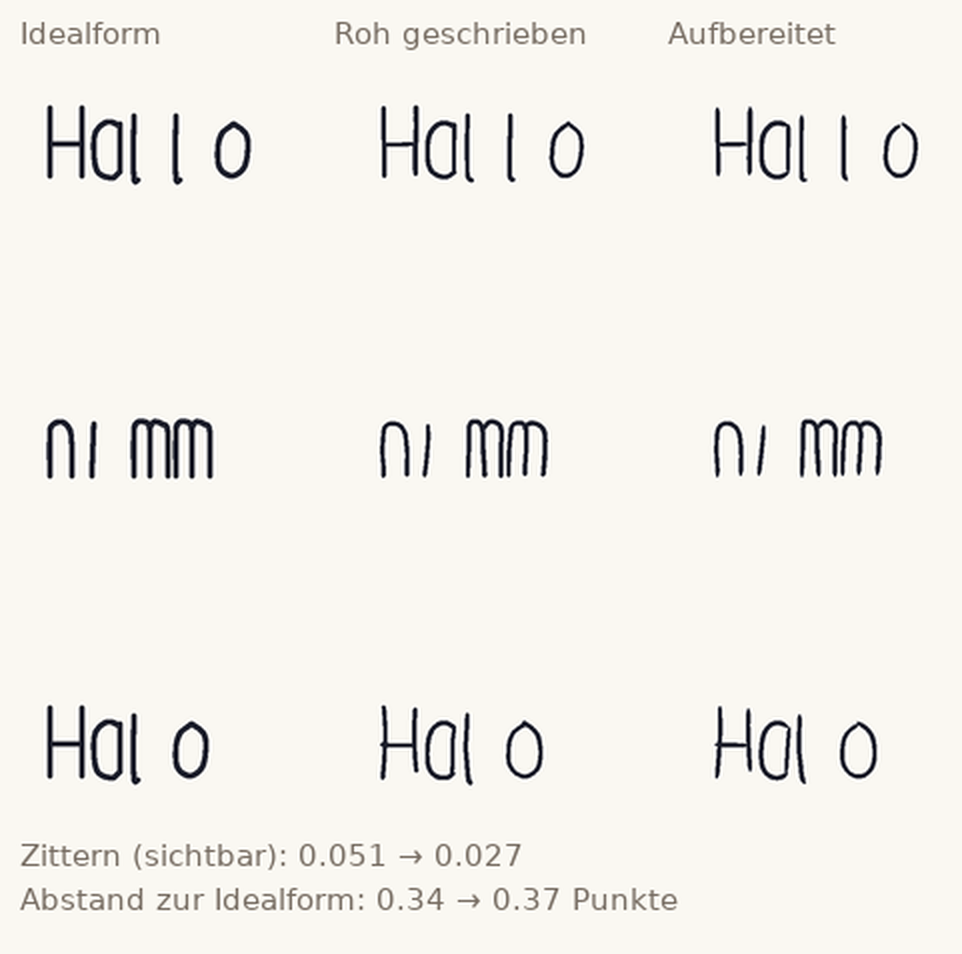

# NeueSwiftApp – Schreibfläche „Tinte“

Eine iPad-App für **Swift Playgrounds**: eine große, unbegrenzte Schreibfläche
für den Apple Pencil. Kein Hauptmenü, kein Speichern, keine Werkzeugleiste –
App öffnen, schreiben, zoomen, verschieben.

Der Kern ist die **Tinten-Engine**: Sie nimmt schnelle, unsaubere Striche an und
macht daraus ruhige, gleichmäßige Handschrift – und zwar **sichtbar**: Jede
Linie *verformt* sich nach dem Abheben des Stifts in ihre schöne Form, statt
ausgetauscht zu werden. Die Engine lernt dabei aus deiner eigenen Schrift.

| | |
| --- | --- |
| App-Paket | `NeueSwiftApp.swiftpm` (SwiftUI + UIKit, iOS 17) |
| Bundle-ID | `com.example.neueswiftapp` (**Platzhalter**) |
| Anzeigename | `NeueSwiftApp` (**Platzhalter**) |
| PencilKit | wird **nicht** benutzt – Eingabe, Glättung und Zeichnen sind selbst gebaut |
| Default-Branch | `main` |
| Prüfungen | `.github/workflows/build-check.yml` |

## Auf dem iPad öffnen (Swift Playgrounds)

1. Auf dem iPad dieses Repository als ZIP herunterladen (GitHub → *Code* →
   *Download ZIP*).
2. In der **Dateien**-App auf die ZIP-Datei tippen – sie wird entpackt.
3. Im entpackten Ordner liegt **`NeueSwiftApp.swiftpm`**. Auf diesen Ordner
   tippen: iOS bietet *In Swift Playgrounds öffnen* an. Alternativ Swift
   Playgrounds starten, in der Seitenleiste *Öffnen* wählen und den Ordner
   auswählen.
4. Oben auf **▶** tippen. Die App startet im Vollbild mit der Schreibfläche.

Voraussetzungen: iPadOS 17 oder neuer, Apple Pencil (getestet werden soll es mit
dem Apple Pencil Pro), Swift Playgrounds 4.6 oder neuer. Ohne Pencil lässt sich
mit dem Finger schreiben (z. B. im Simulator) – sobald einmal ein Pencil erkannt
wurde, schreiben nur noch Stifte, Finger zoomen.

## Bedienung

| Geste | Wirkung |
| --- | --- |
| Apple Pencil | schreiben |
| Zwei Finger ziehen | verschieben |
| Zwei Finger auf-/zuziehen | zoomen (um den Punkt zwischen den Fingern) |
| Zwei Finger doppeltippen | Zoom zurücksetzen (100 %, Ursprung) |
| Drei Finger tippen | letzten Strich zurücknehmen |

Sonst gibt es nichts: kein Menü, keine Einstellungen, kein Speichern.

## Wie aus „schmierig“ „schön“ wird

Der Weg eines Strichs (`NeueSwiftApp.swiftpm/Core/Ink/`):

1. **Eingabe** (`InkCanvasView`): `touchesMoved` mit `coalescedTouches` – beim
   Apple Pencil bis zu 240 Abtastungen pro Sekunde, dazu Druck, Neigung und
   Zeitstempel. Ohne diese Zwischenabtastungen wird schnelles Schreiben eckig.
2. **Säubern und Abtasten** (`PolylineGeometry`, `SignalFilters`): Doppelpunkte
   weg, Median gegen Ausreißer, dann gleichmäßiges Resampling entlang der
   Bogenlänge. Alle weiteren Schritte arbeiten in konstanten Punktabständen.
3. **Ecken finden** (`CornerDetector`): Eine „n“-Spitze oder ein „v“-Knick muss
   scharf bleiben. Wer alles glättet, bekommt verwaschene Buchstaben.
4. **Spline-Glättung** (`SplineSmoother`): Durch jeden Abschnitt zwischen zwei
   Ecken wird eine B-Spline-Kurve gelegt, die mit möglichst wenigen Stützstellen
   auskommt, aber an allen Punkten vorbeiläuft – mit Strafterm auf die
   Biegeenergie und verankerten Enden. Kurzwelliges Zittern kann die Kurve
   zwischen zwei Stützstellen gar nicht erst darstellen, große Buchstabenformen
   bleiben. Warum nicht einfach ein Tiefpass? Ein gleitender Mittelwert zieht
   jede Stelle nach innen; gemessen an einem Kreis wurde aus 52 Punkten Höhe ein
   Oval von 26. Die Spline-Anpassung hält denselben Kreis auf 0,02 Punkte.
6. **Formanpassung** (`ShapeSnapping`, `PrimitiveFitting`): Fast gerade
   Abschnitte werden ganz gerade, fast runde werden zum Kreisbogen – abgestuft
   nach Fit-Fehler, nie mit Gewalt.
7. **Endpunkte halten** (`holdEndpoints`): Ein Strich bleibt dort, wo der Stift
   aufgesetzt und abgehoben hat. Genau diese Stellen verbinden Buchstaben.
8. **Breite** (`WritingStyle.width`): aus Druck, Tempo und Stiftneigung, weich
   auslaufend an beiden Enden – wie bei einer echten Feder.
9. **Überschwinger** (`TerminalTrimmer`): Die winzigen Häkchen, die beim schnellen
   Schreiben am Strichende entstehen, werden entfernt.
10. **Neigung** (`applySlant`): hohe Striche werden an die gelernte Neigung
    angeglichen (gedeckelt, damit die Schrift nicht verbogen wird).
11. **Verbindungen** (`JunctionWelder`): Endet ein Strich in der Nähe eines
    anderen, wird er weich daran gezogen – keine Lücken, keine Versätze.

### Das Lernen

`WritingStyle` führt eine laufende Statistik über die eigene Schrift: Zittern,
Neigung, typischer Druck, typisches Tempo. Daraus folgen der Stützstellenabstand
der Spline-Glättung (mehr Zittern → weitere Stützstellen), Fit-Toleranz,
Vorschau-Weite und Neigungskorrektur. Am Anfang ist das Profil unsicher und
korrigiert kaum; mit jedem Strich wird es sicherer. Nichts davon wird
gespeichert oder verschickt – das Profil entsteht in der Sitzung und ist beim
nächsten Start wieder bei null.

### Die Animation

`LiveStroke` hält zwei Geometrien: was gerade auf dem Bildschirm liegt und was
das Ziel ist. Nach dem Abheben wird die sichtbare Linie Punkt für Punkt in die
Zielgeometrie überführt – mit einer Welle vom Strichanfang zum -ende, die jeden
Punkt leicht versetzt startet. Die Linie fließt also in ihre schöne Form
(`LiveStroke.beginMorph`, `advance`). Erst wenn sie zur Ruhe kommt, wird sie als
eigener Layer dauerhaft gezeichnet.

## Zeichnen und Zoomen

Die Tinte liegt in **Seitenkoordinaten**. Zoom und Verschiebung sind eine
Transformation der Tintebene (`InkViewport`), nicht ein Neuzeichnen: Jeder Strich
ist ein eigener `CAShapeLayer` mit Vektor-Kontur und bleibt deshalb beim Zoomen
scharf. Die Kontur selbst kommt aus `InkRibbon`: links und rechts der Mittellinie
ein Rand aus den punktweisen Breiten, runde Endkappen, weiche Kurven und eckige
Führung an erkannten Ecken. Bei sehr vielen Strichen werden die ältesten zu einem
Layer zusammengefasst, damit die Zahl der Layer begrenzt bleibt.

## Messungen aus der Simulation

Weil sich „schön“ schwer am Gerät beurteilen lässt, wurde die Geometrie der
Engine zusätzlich als Python-Nachbau (numpy, außerhalb der App) gegen
Idealformen gemessen: sechs Buchstabenformen (Gerade, Ecke, Bogen, geschlossener
Kreis, Schleife, Haken), je drei Zufallsstriche, mit künstlichem Zittern in der
Hand und Rauschen im Signal. Gemessen wird der mittlere Abstand zur Idealform und
die Rauheit (mittlere zweite Differenz – das, was das Auge als „zittrig“ sieht):

| Zittern der Eingabe | Fehler zur Idealform | Rauheit |
| --- | --- | --- |
| 0.25 | 0.175 → 0.176 (+0.7 %) | 0.051 → 0.039 (−23 %) |
| 0.45 | 0.290 → 0.271 (−6.6 %) | 0.051 → 0.039 (−24 %) |
| 0.70 | 0.442 → 0.410 (−7.1 %) | 0.051 → 0.039 (−24 %) |



*Dieselben Striche dreimal: links die Vorgabe, in der Mitte so, wie ein
schneller, zittriger Stift sie liefert (geglättete Vorschau), rechts das
Ergebnis der Engine. Das Zittern (mittlere zweite Differenz) sinkt in diesem
Beispiel von 0.051 auf 0.027, während der Abstand zur Idealform mit 0.34 → 0.37
Punkten bei etwa 3 Punkten Strichbreite praktisch gleich bleibt.*

Das ist der Kern des Versprechens: Die Rauheit sinkt um rund ein Viertel, ohne
dass die Schrift dabei von der gewollten Form wegwandert. Zwei frühere Ansätze
sind an genau dieser Tabelle gescheitert und wurden verworfen:

- **Gleitender Mittelwert / FIR-Kern:** Der Fehler stieg auf das Vier- bis
  Fünffache (0.19 → 1.48). Ein Tiefpass zieht jede Form nach innen; der gelernte
  Kern bekam dazu negative Randgewichte und verschob jeden Strich um Punkte.
- **Glättung im Winkelbereich:** Sie zerstörte geschlossene Formen – aus einem
  „o“ mit 26 Punkten Höhe wurde ein Oval von 11.

Die Zahlen sind eine Eigenschaft des Algorithmus, keine Messung der App auf dem
iPad. Der Nachbau liegt bewusst nicht im App-Paket.

## Projektstruktur

```
NeueSwiftApp.swiftpm/            Swift-Playgrounds-App-Paket
  Package.swift                  Manifest (AppleProductTypes, iOS 17)
  App.swift                      @main-Einstieg (SwiftUI)
  Views/ContentView.swift        die App: nur die Schreibfläche
  Views/InkCanvas.swift          SwiftUI-Verpackung der UIKit-Ansicht
  Ink/                           UIKit-Schicht (Eingabe, Rendering, Gesten)
    InkCanvasView.swift          Stift-Eingabe, Display Link, Zoom, Zurücknehmen
    InkRibbon.swift              Kontur eines Strichs (variable Breite, Ecken)
    InkStrokeStore.swift         Layer je Strich, Zusammenfassen, Zurücknehmen
    LiveStroke.swift             Morph-Animation roh → schön
    InkViewport.swift            Zoom und Verschiebung
    DisplayLinkProxy.swift       Display Link ohne Zyklus
  Core/                          plattformunabhängige Logik (nur Foundation)
    AppMetadata.swift            Name, Bundle-ID, Version
    SemanticVersion.swift        Versionsvergleich
    Ink/                         die Tinten-Engine
      Vec2.swift                 Vektor und Mathe-Helfer
      PolylineGeometry.swift     Bogenlänge, Resampling, Abstände
      LinearAlgebra.swift        kleine dichte Gleichungssysteme
      SignalFilters.swift        Median, Gauß, hochfrequente Energie
      CornerDetector.swift       echte Ecken finden
      SplineSmoother.swift       B-Spline-Anpassung (Glättung)
      PrimitiveFitting.swift     Gerade und Kreis anpassen
      ShapeSnapping.swift        Linie sanft auf die Form ziehen
      TerminalTrimmer.swift      Überschwinger an den Enden
      JunctionWelder.swift       Strichenden verbinden
      WritingStyle.swift         gelerntes Schreibprofil
      StrokeBeautifier.swift     die Aufbereitungs-Pipeline
      InkEngine.swift            Engine: Vorschau, Abschluss, Lernen
  Assets.xcassets/               App-Icon (Platzhalter)
docs/                            Bilder für diese Beschreibung
ci/                              Prüf- und Automatisierungsskripte
Tests/                           Logik-Tests und Tests der Auto-Merge-Logik
.github/workflows/               GitHub Actions
AGENTS.md / CONTRIBUTING.md      Ablauf, Einstellungen, Fehlersuche
```

## Lokale Prüfungen

Dieselben Befehle, die auch in GitHub Actions laufen:

```sh
ci/run-swift.sh ci/swift-check.sh parse     # Syntax aller Swift-Dateien
ci/run-swift.sh Tests/run-core-tests.sh     # Typ-Prüfung + Tests der App-Logik
ci/run-swift.sh ci/lint.sh                  # swift-format
ci/check-shell.sh                           # Shell-Skripte (bash -n, shellcheck)
ci/check-workflows.sh                       # Workflows (SHA-Pinning, actionlint, YAML)
Tests/auto-merge.test.sh                    # Auto-Merge-Entscheidungen (ohne Netz)
```

`ci/run-swift.sh` benutzt den offiziellen Container `swift:6.2-noble`
(überschreibbar mit `SWIFT_IMAGE`). Ohne Docker genügt ein lokales Swift mit
`SWIFT_IMAGE=local`. Der iOS-Build braucht macOS mit Xcode:

```sh
ci/select-xcode.sh
ci/ios-build-test.sh        # Build + Start im Simulator
ci/build-ipa.sh             # unsignierte IPA nach build/NeueSwiftApp.ipa
```

Die Tests der Tinten-Engine laufen unter Linux mit `swiftc` – ohne UIKit, ohne
iPad. Sie prüfen echte Eigenschaften: dass Resampling den Punktabstand hält,
dass die Spline-Glättung Zittern senkt und Endpunkte festhält, dass eine Gerade
gerade bleibt und ein Kreis ein Kreis, dass Ecken erkannt und an ihrem Platz
gehalten werden, dass saubere Linien nicht gekürzt werden und dass nichts
abstürzt (leere Eingabe, ein Punkt, doppelte Punkte, ungültige Koordinaten).

## Unterstützte Versionen

| Komponente | Wert | Nachweis |
| --- | --- | --- |
| Swift-Tools (Manifest) | `swift-tools-version: 5.9` (Minimum) | `Package.swift` |
| Swift-Toolchain der Linux-Jobs | 6.2 (`swift:6.2-noble`) | Syntax-, App-Logik- und Format-Job im CI-Lauf |
| iOS-Mindestversion | 17.0 | `Package.swift`, `AppMetadata.minimumIOSVersion` |
| Xcode in CI | **26.6**, iOS-SDK **26.5**, Simulator-Laufzeit **iOS 26.2** | Annotation „macOS-Buildumgebung“ des iOS-Jobs |
| Runner | `macos-26` (iOS-Build, IPA), `ubuntu-24.04` (Linux-Prüfungen) | Workflow-Dateien |
| iPadOS / Swift Playgrounds | **nicht verifiziert** | – |

## Was tatsächlich geprüft wurde

Stand dieses Branches, alle Jobs des Workflows „Swift-Code-Prüfung“ grün:

| Prüfung | Ergebnis |
| --- | --- |
| `Syntax (alle Swift-Dateien)` | ✅ alle `.swift`-Dateien geparst (Swift 6.2 im Container) |
| `App-Logik (Typen und Tests)` | ✅ echte Typ-Prüfung und Regressionstests der Tinten-Engine |
| `swift-format (Format)` | ✅ keine Abweichung von `.swift-format` |
| `Skripte und Workflows (Lint und Tests)` | ✅ Shell-Skripte, Workflows, Auto-Merge-Szenarien |
| `iOS-Build und Simulator-Smoke (Xcode)` | ✅ Build mit iOS-SDK, Installation und Start im Simulator |

**Nicht geprüft:** Swift Playgrounds auf dem iPad, echtes Gerät und damit auch
das Schreibgefühl mit dem Apple Pencil, Signierung und App-Store-Upload. Ein
Linux-Syntaxcheck und ein Simulator-Build ersetzen keinen Test auf echter
Hardware: Ob sich die Schrift mit diesem Pencil und dieser Handschrift wirklich
schön anfühlt, lässt sich nur am Gerät beurteilen. Die Stellschrauben dafür
liegen alle in `WritingStyle` und `StrokeBeautifier`.

## Auto-Merge in Kurzform

Ein Push auf `arena/**`, `ai/**` oder `agent/**` erzeugt automatisch einen
Pull Request; nach grünen Pflichtprüfungen wird er nach `main` gemergt. Änderungen
an `.github/`, `ci/` und `Tests/` werden **nie** automatisch gemergt – dieser
Branch ändert `Tests/`, braucht also einen Merge von Hand. Details:
[AGENTS.md](AGENTS.md), [CONTRIBUTING.md](CONTRIBUTING.md).

## IPA

Die IPA ist **unsigniert** und lässt sich nicht direkt installieren. Sie muss mit
einer eigenen Apple-ID signiert werden (z. B. Sideloadly, AltStore). Es werden
keine Apple-Zugangsdaten, Zertifikate oder Tokens in diesem Repository oder in
GitHub hinterlegt – und niemand muss sie im Chat weitergeben.
